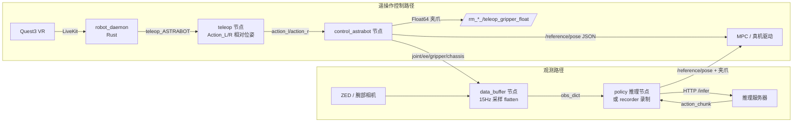

# Astrabot 观测获取与控制接口文档(面向 AI 阅读)

> 本文档面向需要在 Astrabot 机器人上读取观测(observation)与下发控制动作(action)的 AI / 策略 / 工具开发者。
> 内容基于 `robot_data_collection` 数据采集图与 `robot_policy_deploy` 部署图的实际代码,精确到键名、维度、数值格式与时序契约。

## 1. 总览

机器人为双臂人形(Astrabot,EVT 1.1 / xr1),有:

- 左/右 7 自由度机械臂 + 各 1 个夹爪;
- 2 自由度头部;
- 可选移动底盘;
- 3~4 路相机(头 ZED 单目 + 左右腕部 USB + 可选胸口鱼眼);
- 遥操作通过 LiveKit VR(Quest3)接入;
- 策略通过 HTTP 推理服务器或本地模型接入。

两条核心数据流:



## 2. 关键代码文件索引

| 文件 | 作用 |
|---|---|
| `projects/robot_common/dora_nodes/astrabot/robot_control_node_odom.py` | Dora 封装节点:接收遥操作动作、发布观测状态与关节增量动作 |
| `projects/robot_common/dora_nodes/astrabot/robot_control_odom.py` | 核心控制器 `AstrabotRobotController`:TF 位姿、状态构建、`step_teleop`、复位 |
| `projects/robot_common/robot_setups/astrabot/astrabot_control.py` | ROS2 机器人控制基类:夹爪状态机、`/reference/pose` 发布、VR 滤波 |
| `projects/robot_common/robot_setups/astrabot/astrabot_robot_configs.py` | 特征(feature)定义:观测/动作的键名、维度、dtype、fps |
| `projects/robot_common/dora_nodes/data_buffer/data_buffer_node.py` | data_buffer Dora 节点:按 15Hz 组装 `obs_dict` |
| `projects/robot_common/dora_nodes/data_buffer/shared_memory/data_ring_buffer.py` | 环形缓冲:`SingleDataRingBuffer` / `MultiDataRingBuffer`、`DataBufferMode` 枚举 |
| `projects/robot_data_collection/node/teleop/teleop_livekit_node.py` | 遥操作解析:VR 数据 → `Action_L/R/Head` + 按钮 |
| `projects/robot_data_collection/node/teleop/streaming/livekit_streaming/livekit_teleop_handler.py` | `TeleopFrame`:VR 字符串协议解析 |
| `projects/robot_data_collection/node/recorders/dataset_recorder_node.py` | 录制器:LeRobot 格式(parquet + 视频)落盘 |
| `projects/robot_policy_deploy/node/policy/http_infer_astrabot_deploy_node.py` | 部署推理节点:HTTP /infer → `/reference/pose` + 夹爪 |
| `scripts/replay_ee_pose.py` | 数据重放脚本:parquet 动作 → `/reference/pose` |
| `projects/robot_common/constants.py` | 键名前缀约定(`OBS_*`、`ACTION_*`) |
| 图配置 | `projects/robot_data_collection/graph/astrabot_data_collection_xr1_thor_test.yaml`(采集)、`projects/robot_policy_deploy/graph/astrabot/astrabot_smolVLA_deploy_eepose.yaml`(部署) |

---

## 3. 获取观测向量(Observation)

### 3.1 统一载体:`obs_dict`

观测的统一出口是 **`data_buffer` 节点的 `obs_dict` 输出**(Dora 事件,id = `obs_dict`)。

- 序列化:`pa.array([frame])`,其中 `frame = {feature_key: np.ndarray(已 flatten)}`,即一个单元素 pyarrow **StructArray**。
- 反序列化(Python):

```python
# event["value"] 是 pyarrow Array
obs = event["value"].to_numpy(zero_copy_only=False)[0]  # 得到 dict[str, np.ndarray]
img_flat = obs["observation_images_head"]               # 一维 uint8 数组
```

- 元数据:`metadata["timestamp_us"]`(int,当前时间微秒)。
- 注意:`frame` 中所有数组都是**扁平化**的(`flatten_data=True`),图像为 1-D,状态保留 1-D。

### 3.2 状态特征(feature)维度表

键名定义于 `AstrabotArmConfig._obs_features`(`astrabot_robot_configs.py`),实际值由 `control_astrabot` 节点输出。

| obs_dict 键 | 维度 | 内容 | 来源输出 |
|---|---|---|---|
| `observation_states_joint_angle_left` | (7,) float32 | 左臂 7 关节角 | `control_astrabot/joint_angle_l` |
| `observation_states_joint_angle_right` | (7,) float32 | 右臂 7 关节角 | `control_astrabot/joint_angle_r` |
| `observation_states_joint_angle_head` | (2,) float32 | 头部 2 关节 | `control_astrabot/joint_angle_head` |
| `observation_states_ee_pose_left` | (9,) float32 | 左末端位姿,rotation_6d | `control_astrabot/ee_pose_l` |
| `observation_states_ee_pose_right` | (9,) float32 | 右末端位姿,rotation_6d | `control_astrabot/ee_pose_r` |
| `observation_states_gripper_left` | (1,) float32 | 左夹爪状态 0/1 | `control_astrabot/gripper_l` |
| `observation_states_gripper_right` | (1,) float32 | 右夹爪状态 0/1 | `control_astrabot/gripper_r` |
| `observation_states_chassis` | (3,) float32 | 底盘速度 [vx, vy, ωz] | `control_astrabot/chassis_state` |
| `observation_states_chassis_pose` | (9,) float32 | 底盘位姿 rotation_6d | `control_astrabot/chassis_pose` |

**ee_pose 格式**(9 维,最重要):

```
[x, y, z, rot6d(6)]
```

- 前 3 维是末端在 `base_link` 坐标系下的平移;
- 后 6 维是 **rotation_6d**(3×3 旋转矩阵的前两行,row-major),不是四元数;
- 来源:TF 查询 `base_link → {left,right}_tcp_link`(`get_arm_ee_pose()`),再经 `Transform.to_rep("rotation_6d")` 转换;
- 若需要四元数,用 Gram-Schmidt 还原旋转矩阵(见 4.7 节算法)。

**joint_angle** 来源:`/joint_states` 话题回调,按关节名列表 `LEFT_JOINTS_NAME` / `RIGHT_JOINTS_NAME` 提取。

**gripper 状态**:0.0 = 打开,1.0 = 闭合(已二值化,见 4.5)。

### 3.3 图像特征

| obs_dict 键 | 尺寸 | 通道 | 来源 |
|---|---|---|---|
| `observation_images_head` | 640×480 | 3 (RGB) | ZED 2i 右目(`single_zed_node.py`,输出 `right_image`) |
| `observation_images_left_wrist` | 640×480 | 3 (RGB) | USB 相机,设备别名 `/dev/r_arm_cam`(注意左右互换) |
| `observation_images_right_wrist` | 640×480 | 3 (RGB) | USB 相机,设备别名 `/dev/l_arm_cam` |
| `observation_images_chest`(可选) | 1600×1200 | 3 (RGB) | 胸口鱼眼相机 |

- dtype = uint8,flatten 后长度 = 640×480×3 = 921600(一维)。
- 恢复形状:`img.reshape(480, 640, 3)`;按 `size == h*w*3` 匹配标准分辨率即可(参考 `http_infer_astrabot_deploy_node.py:_ensure_uint8_hwc`)。
- 通道为 RGB(ZED 由 BGRA 转换,webcam 由 BGR 转换)。

### 3.4 动作特征(仅数据采集模式)

`MODE=data_collection` 时 `data_buffer` 的缓冲键 = `sensor_features = obs_features + actions`,多出动作键:

| obs_dict 键 | 维度 | 内容 |
|---|---|---|
| `action_left` | (8,) float32 | [Δj1..Δj7, gripper_cmd],左臂关节增量 |
| `action_right` | (8,) float32 | [Δj1..Δj7, gripper_cmd],右臂关节增量 |
| `action_chassis` | (3,) float32 | 底盘 cmd_vel [vx, vy, ωz] |

- 关节增量由 `control_astrabot` 在 `_handle_state_tick()` 中:每 10ms 累加 Δjoint,每 67ms(15Hz)发布一次并清零;
- 第 8 维 `gripper_cmd` = `gripper_state[side]['cmd']`(二值 0/1);
- `MODE=policy_rollout`(部署)时 **不含动作键**(`buffer_action=False`)。

### 3.5 数据流与时序(采集图)

```
相机(ZED/USB, FPS=15)
control_astrabot: state_tick=10ms(100Hz) 状态输出; pub_tick=5ms(200Hz) 执行遥操作
        │
        ▼
data_buffer: tick=67ms(15Hz) → 环形缓冲 → buffer 满时 get_last() → obs_dict (15Hz)
        │
        ▼
recorder: 收到 obs_dict → LeRobot 格式(parquet + mp4)
```

`data_buffer_node.py` 逻辑要点:

- `MODE` 环境变量决定行为,枚举 `DataBufferMode`:`data_collection` / `policy_rollout` / `human_in_the_loop`;
- `data_collection`:`record_episode_start=False`,直到收到 `episode_status=True`(recorder 回发)才开始在 tick 时输出 `obs_dict`;
- `policy_rollout`:`record_episode_start=True`,`SAMPLE_FPS` 必须指定;
- 缓冲满判定:所有非 optional 键的 `SingleDataRingBuffer.is_buffer_full` 均为真;optional 键(如胸口相机)缺失时填零,不阻塞;
- `get_last()` 返回 `{key: last_sample}`(每键只取最新 1 步,`obs_step=1`)。

### 3.6 部署侧 34 维推理状态向量

部署推理节点(`http_infer_astrabot_deploy_node.py`)把 `obs_dict` 压缩成 **34 维** float 向量发给服务器。顺序**必须**与服务器 `STATE_COLUMNS` 一致:

```
[joint_left(7), joint_right(7), ee_pose_left(9), ee_pose_right(9),
 gripper_left(1), gripper_right(1)]            # 共 34 维
```

- 键与维度表即 `_STATE_SPEC`;ee_pose 直接使用 9 维 rotation_6d,不需要转四元数;
- 缺失键补零,维度不符截断/补零(并打印 `⚠` 警告);
- 注意:头部关节、底盘状态**不进入** 34 维状态(除非服务器端另行约定)。

### 3.7 三种获取观测的方式

1. **订阅 Dora `obs_dict`**(推荐,采集/部署图内):见 3.1 反序列化代码。
2. **直接订阅 ROS2 话题**(不经过 Dora):
   - `/joint_states`(sensor_msgs/JointState)关节角;
   - TF `base_link → {left,right}_tcp_link` 末端位姿;
   - `/odom`(nav_msgs/Odometry)底盘;
   - `/rm_left/rm_driver/teleop_gripper_float` 回读夹爪命令。
3. **离线读 parquet 数据集**(LeRobot 格式):`data/chunk-000/episode_XXXXXX.parquet`,列名即 feature 键(见 `scripts/replay_ee_pose.py`)。

---

## 4. 控制机器人

### 4.1 三条控制路径

| 路径 | 输入 | 输出到机器人 |
|---|---|---|
| 遥操作(采集) | `teleop/Action_L`、`teleop/Action_R`(8 维相对位姿) | `control_astrabot` → `/reference/pose` + 夹爪 |
| 策略推理(部署) | HTTP `/infer` 返回 action/chunk(20 维/步) | policy 节点 → `/reference/pose` + 夹爪 |
| 数据重放 | parquet 中 `action_left/right`(10 维 pose 动作) | `replay_ee_pose.py` → `/reference/pose` + 夹爪 |

机器人统一通过 ROS2 话题驱动:

| 话题 | 类型 | 内容 |
|---|---|---|
| `/reference/pose` | `std_msgs/String` | JSON:`{"left_arm": {"position": [x,y,z], "orientation": [qx,qy,qz,qw]}, "right_arm": {...}}`(MPC 参考位姿,末端绝对位姿) |
| `/rm_left/rm_driver/teleop_gripper_float` | `std_msgs/Float64` | 左夹爪命令,0~1 |
| `/rm_right/rm_driver/teleop_gripper_float` | `std_msgs/Float64` | 右夹爪命令,0~1 |
| `/astrabot/left_ee_vr/pose` 等 | `geometry_msgs/Pose` | VR 原始/滤波位姿(调试用) |

### 4.2 遥操作动作格式

`teleop_livekit_node.py` 输出 `Action_L` / `Action_R` / `Action_Head`:

```
8 维: [x, y, z, qx, qy, qz, qw, gripper]
```

- 位姿为 **VR 相对位姿**(相对当前 origin),元数据:`is_relative=True`、`is_valid`(握手扳机 `Axis_HandTrigger_* >= 0.5` 且 `isSafe_*`);
- gripper 第 8 维来自 VR 扳机轴(0~1),`GRIPPER_MODE` 支持按压保持模式;
- 按钮信号:`Button_A`(录制开关)、`Button_B`(复位)、`Button_X`(下一技能)、`Fun_Button_Y`(终止/停止)、摇杆推动(状态标记 abort/smooth/fail/corrected)。

### 4.3 control 节点内部处理

`robot_control_node_odom.py`(Dora 封装)事件处理器:

- `action_l/action_r` → `_handle_teleop_action()`:
  - 取 `event["metadata"]["is_valid"]`;无效动作不更新臂(用于重置 origin);
  - 调用 `robot.step_gripper(action, side)`(夹爪状态机,见 4.5);
  - `abs_quat_to_rot6d(action, side, ...)`:`abs = origin * relative` 得到绝对 VR 位姿,可选 `SlidingWindowPoseFilter` 滤波,输出 `action_{side}_filter`(10 维,rotation_6d,调试用);
  - 置 `arm_step_flags[side] = True`。
- `pub_tick`(5ms)→ `_handle_step_tick()`:任一臂 flag 为真则调 `robot.step_teleop()`:
  - `step_teleop()` 取 VR 位姿(滤波后或原始)发布 `/reference/pose` JSON(双臂),这是遥操作**真正驱动机器人**的动作。
- `state_tick`(10ms)→ `_handle_state_tick()`:发布状态(3.2 表)+ 累加并每 67ms 发布关节增量动作(3.4)。
- `time_tick`(100ms)→ 复位计数与 `renew_ee_pose()`。
- `reset`(Button_B 长按 >100ms)→ `robot.reset()`(发布默认复位位姿到 `/reference/pose`)并重新校准原点。

### 4.4 `/reference/pose` JSON 协议(核心控制接口)

```json
{
  "left_arm": {
    "position": [0.271, 0.454, 0.923],
    "orientation": [-0.308, 0.698, -0.577, 0.291]
  },
  "right_arm": {
    "position": [0.302, -0.280, 0.900],
    "orientation": [-0.668, 0.251, -0.355, 0.604]
  }
}
```

- 四元数为 **xyzw** 顺序;
- 消息**必须同时包含双臂**;
- 末端位姿为绝对位姿(`base_link` 系);
- 发布方示例(`step_policy`):position 取动作前 3 维、orientation 取动作 3:7 维(xyzw)。

### 4.5 夹爪控制

**命令值语义**:`0.0` = 打开,`1.0` = 闭合(或保持夹紧)。

**遥操作路径状态机**(`astrabot_control.py:step_gripper`):

- 阈值:`GRIPPER_OPEN_THRESHOLD=0.9`,`GRIPPER_CLOSE_THRESHOLD=0.1`;
- 触发逻辑:命令 >0.9 触发一次"开"意图;<0.1 且已触发 → 进入 `hold`,夹爪值强制 1.0;再次 >0.9 解除 hold(扳机二值开关);
- 记录用状态二值化:`cmd/state = 1.0 if 命令 > 0.4 else 0.0`;
- 发布:`Float64(gripper_position)` 到 `/rm_{side}/rm_driver/teleop_gripper_float`。

**推理路径**(`http_infer_astrabot_deploy_node.py`):直接按阈值二值化:

```python
GRIPPER_THRESHOLD = 0.4
gripper_msg.data = 1.0 if float(pose_quat[7]) >= GRIPPER_THRESHOLD else 0.0
```

- `pose_quat[7]` 是每臂动作的第 8 维(推理值 0~1);
- 发布到 `/rm_left/rm_driver/teleop_gripper_float` 与 `/rm_right/rm_driver/teleop_gripper_float`。

### 4.6 复位与原点

- 默认复位位姿硬编码在控制/推理节点(位置 + xyzw 四元数,双臂);
- 触发方式:遥操作 Button_B 长按(>100ms)、部署节点 `RESET_ON_START=1` 启动时、`replay_ee_pose.py` 回放前;
- 复位只发布一次 `/reference/pose`,不等待到位;随后重新建立 VR 原点(`set_new_origin`)。

### 4.7 推理动作格式与解析(部署路径)

HTTP 请求/响应(`client_example.py` 协议):

```json
POST {INFER_SERVER_URL}/infer
{
  "task": "astrabot_xr1:restaurant_robot_3_task",
  "state": [34 维 float],
  "images": {"head": "<jpeg base64>", "left_wrist": "...", "right_wrist": "..."},
  "disabled_cameras": []
}
响应: {"inference_time_ms": 123.4, "action": [20 维 float], "action_chunk": [[20], [20], ...]}
```

动作格式(每臂):

- `rotation_6d`(默认):**10 维** = [x, y, z, rot6d(6), gripper];双臂共 20 维(左前右后);
- `euler`:7 维 = [x, y, z, roll, pitch, yaw, gripper];
- `action_chunk` 为多步动作块,每步 20 维;节点按 `ACTIONS_PER_INFER` 步执行后重新推理。

**rotation_6d → 四元数算法**(`_rot6d_to_quat`,含零向量保护):

```python
a1, a2 = rot6d[:3], rot6d[3:6]          # 旋转矩阵前两行
b1 = normalize(a1)                       # 退化时取 [1,0,0]
b2 = a2 - dot(b1, a2) * b1; b2 = normalize(b2)
b3 = cross(b1, b2)                       # 第三行
R = vstack([b1, b2, b3])                 # 3×3, 行主序
quat_xyzw = scipy.R.from_matrix(R).as_quat()
```

执行节奏(部署节点,已改为后台推理):

- 空格松开切换连续执行;每 `STEP_INTERVAL`(0.1s)执行动作块一步;
- 动作块耗尽时后台线程发起新推理(不阻塞键盘停止);
- 活跃臂发推理位姿,非活跃臂发"当前位姿保持"(`_get_hold_pose`,从最新 `observation_states_ee_pose_*` 提取);
- 夹爪按 4.5 节二值化发布。

### 4.8 头部与底盘

- 头部:`Action_Head`(8 维同格式)由遥操作驱动(图内接线不同);观测为 `joint_angle_head`(2 维);
- 底盘:命令 `action_chassis`(3 维 cmd_vel),观测 `chassis_state`(3 维)/ `chassis_pose`(9 维)。

---

## 5. 时序契约(务必遵守)

| 项 | 频率 | tick 周期 |
|---|---|---|
| 相机输出 | 15Hz | 67ms |
| data_buffer 采样 | 15Hz(SAMPLE_FPS=15) | 67ms |
| recorder 写入 | 15Hz(FPS=15) | — |
| control 状态输出 | 100Hz | state_tick 10ms |
| control 动作发布 | 200Hz | pub_tick 5ms |
| 关节增量动作 | 15Hz | 67ms 累积窗口 |
| 复位计数 / renew | 10Hz | time_tick 100ms |

- **对齐陷阱**:相机 FPS、`data_buffer` 的 `SAMPLE_FPS`、`recorder` 的 `FPS` 必须一致(均为 15);不一致会丢帧或重复。67ms ≈ 15Hz(部分图注释误写为 30Hz,30Hz 应为 33ms);
- **相机别名陷阱**:`/dev/l_arm_cam` 与 `/dev/r_arm_cam` 的左右含义在采集图 YAML 中互换(`left_wrist_camera` 用 `/dev/r_arm_cam`),换机器时需核对 udev 符号链接。

---

## 6. 常用操作示例(伪代码)

### 6.1 读取一次观测(Dora 节点内)

```python
def on_event(event):
    if event["type"] == "INPUT" and event["id"] == "obs_dict":
        obs = event["value"].to_numpy(zero_copy_only=False)[0]
        joints_l = obs["observation_states_joint_angle_left"]   # (7,) float32
        ee_r     = obs["observation_states_ee_pose_right"]      # (9,) rotation_6d
        img_head = obs["observation_images_head"].reshape(480, 640, 3)  # uint8 RGB
```

### 6.2 驱动双臂到目标位姿(ROS2)

```python
import json
from std_msgs.msg import String

msg = String()
msg.data = json.dumps({
    "left_arm":  {"position": [x, y, z], "orientation": [qx, qy, qz, qw]},
    "right_arm": {"position": [x, y, z], "orientation": [qx, qy, qz, qw]},
})
pub = node.create_publisher(String, "/reference/pose", 10)
pub.publish(msg)
```

### 6.3 发送夹爪命令(0/1)

```python
from std_msgs.msg import Float64
g = Float64(); g.data = 1.0  # 闭合; 0.0 = 打开
node.create_publisher(Float64, "/rm_left/rm_driver/teleop_gripper_float", 10).publish(g)
```

### 6.4 解析 20 维推理动作并发布

```python
action = result["action_chunk"][0]                 # (20,)
left  = action[0:10]                               # [x,y,z,rot6d(6),gripper]
right = action[10:20]
# 每臂: rot6d→quat(见 4.7), 组装 /reference/pose JSON 并发布;
# gripper = 1.0 if 第10维 >= 0.4 else 0.0, 发布 Float64。
```

---

## 7. 注意事项汇总

1. **rotation_6d 无处不在**:观测 ee_pose(9 维)与推理动作(10 维)都用 rotation_6d,不是四元数;只有 `/reference/pose` 使用 xyzw 四元数。
2. **夹爪二值化阈值 0.4** 是部署节点与记录状态(`cmd/state`)的约定;遥操作驱动层发布的是原始扳机值(经 hold 状态机)。
3. **obs_dict 是单元素 StructArray**:`[0]` 取第一行,得到 dict;忘记索引会拿到 ndarray。
4. **flatten 数据**:图像 921600 维一维数组,恢复需按 `H*W*3` 匹配(480,640)。
5. **状态缺失补零**:`_build_state` 对缺失键静默补零,推理仍会执行——需自行确认 control 节点已就绪。
6. **非活跃臂**:部署节点发布"当前位姿保持",不是复位位姿;观测不可用时才回退复位位姿。
7. **停止信号**:采集图用 `teleop/Fun_Button_Y`,部署图用 `keyboard/esc`。
8. **凭证**:LakeFS 密钥在 YAML 中以明文存在,禁止提交新凭证(见 `AGENTS.md`)。
